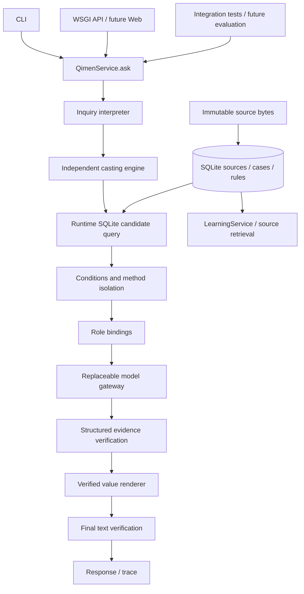

# 技术架构与真实数据流

Phase 0 用 Python 3.11+ 标准库、SQLite（FK/JSON/FTS5）和 WSGI。没有运行时第三方依赖，不安装 CUDA 或语言模型。单机研究优先，模型协议和存储边界允许后续替换。配置 TOML 目前为文档模板；实际 CLI 参数明确，不存在隐式配置或网络模型选择。

## 当前已接通

`python -m qimenllm ask` 和 `POST /v1/ask` 均实例化/调用同一个 `QimenService.ask`。入口依次执行问题上下文、起盘尝试、真实 SQL、适用性、绑定和前置门槛。前置不足时模型不调用，trace 标 skipped/not_run，输出不能断案的状态。空流程不是完整专业推理流程成功。

对暂存工程数据，通过依赖注入的中性测试起盘器和模型适配器，测试证明：数据库 → 条件选择 → 模型实际接收规则和同一个 Chart → 事实验证 → 固定渲染 → 最终检查。这只验证接线；没有任何已实现的真实排盘、自然语言理解或专业模型。

Chart dataclass 冻结，内部盘面使用单份 JSON 字符串，读取返回副本。历史盘 `charts.chart_json` 保存同一不可变整体，哈希校验。未来规范化九宫视图必须从它投影，禁止另算。尚未将原书不可解析盘强制填为九宫或 engine_verified。

规则条件 DSL 当前支持 require/exclude 的 eq/ne/in/present，键缺失或 null 均为 unknown。只有来源 confirmed、structured、applicability_confirmed、compiled、非 reference/disputed 才可激活；多种可用方法而未指定时 disputed；角色冲突阻断。不支持的复杂条件需新增明确编译器与回归，不能降级自由解释。

## 输出协议边界

`Analysis → Claim(kind,reference,key,value_json)` 仅支持盘面事实和规则绑定的严格复述。验证器核对 chart_id、状态、实际值、激活规则和绑定值；空 claims 不成功。渲染器只逐字展示已核对值，最后对完整渲染一致性检查。

当前不支持专业综合推断、应期、任意自由文本事实检查，也不冒充通用自然语言校验器。`structurally_verified` 的 `professional_analysis_completed` 仍为 false。后续加入专业 evidence graph 和受控中文解释时，必须扩展契约与验收，不能将此状态改名充专业通过。

## 资料、事务与权限

SQLite BLOB 为权威字节；`data/raw_books/<sha256>.utf8` 为可检查镜像。数据库事务整体提交书章、修订、来源、FTS 和版本。镜像先以独占方式持久化，事务失败可能留下未引用镜像；它不是已导入资料，不可静默删除，可在审计后独立清理。原始字节和索引内容一致性由 audit 检查。中文采用有界字面查询，FTS 索引另存，不假设 unicode61 可以中文分词。

可信维护工具才能写资料。问事 API 没有导入、修改或训练路由；正文与古籍视作数据。SQL 参数化。schema 的 append-only 触发器防止日常工具误改，不声称防止有磁盘所有权的人删除触发器。

## trace 与异常

每次请求含 request_id；内存 trace 包含阶段状态、SQL、候选/激活规则 ID、来源、条件拒绝原因、盘 ID、生成 claim 数、验证结果、最终检查。默认不保存姓名、问事原文、背景值或模型原始含隐私内容。可信本地调用者显式构造 `QimenService(..., capture_debug=True)` 时，内存 trace 会包含模型实际请求结构及其返回的完整 Analysis；此开关不是问事 API 参数，默认 CLI/API 均关闭，不写磁盘。持久化模型 I/O 尚未实现，启用前必须增加权限与保留期控制。

`blocked`、`model_unavailable`、`generation_error`、`verification_failed`、`final_verification_failed`、`structurally_verified` 分开。不对基础事实正确性、真实预测准确性做无依据估算。

## API 与未来部署

`GET /health`，`POST /v1/ask`，`POST /v1/learn`。JSON 上限 64 KiB，错误不泄露提交内容；不输出访问日志、不缓存。研究服务器固定监听 127.0.0.1，不是生产服务器；Phase 0 没有账户、TLS、限流、公众 UI 和生产授权。未启动常驻服务或公开任何端口。

未来前端仅调用 API。生产拆为入口/鉴权、核心服务、资料存储、推理 worker、异步实验和受限维护面；公众账户无法写权威数据。选择 FastAPI 等框架时先证明与统一 service 的集成，不创建第二条 Prompt 路径。

## 迁移

初始 `001_initial.sql` 和生成的 append-only 触发器共同计算迁移哈希。重复 init 校验已应用哈希，不重建或覆盖。初版定稿后的 schema 变更必须增加 migration 和备份、迁移/回滚测试；本版 migration runner 只支持 v1，后续执行器待实际需要时实现。

本轮开发曾重新建立尚无任何用户数据的初始空库以同步 v1 定稿；未迁移或覆盖原文、旧项目及冻结数据。真实资料入库后不得这样做。

## 后续 GitHub 同步

用户已要求每次数据更新同步 GitHub。维护 CLI 在 import/annotate 事务提交后调用 snapshot 和 sync；失败不丢已保存内容，返回 pending/退出码2。问事/学习运行时仍不修改权威数据、不调用同步。JSONL + 原始字节导出可恢复全部权威表，搜索索引重建；初始化新增 seed_empty=False 仅供恢复新库，不改变 schema 或现有库。

sync 依次验证指定私有目标、回归、受控 staging、commit/push 和远端 SHA；仅本地提交不能报完成。当前 CLI 的 GitHub API 被网络允许列表拒绝，连接器无建库工具，所以新仓库及首次上传仍待外部访问配置，不能以已实现同步模块替代真实 push。详见 GITHUB_SYNC。
