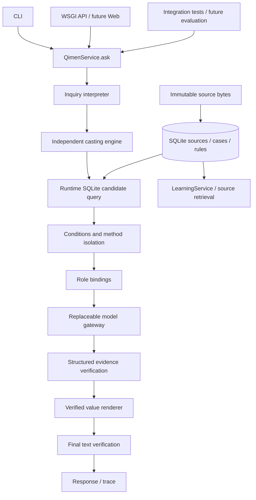

# 技术架构与真实数据流

项目用 Python 3.11+ 标准库、SQLite（FK/JSON/FTS5）和 WSGI。没有运行时第三方依赖，不安装 CUDA 或语言模型。单机研究优先，模型协议和存储边界允许后续替换。配置 TOML 目前为文档模板；实际 CLI 参数明确，不存在隐式配置或网络模型选择。

## 当前已接通

`python -m qimenllm ask` 和 `POST /v1/ask` 均实例化/调用同一个 `QimenService.ask`。入口依次执行问题上下文、起盘尝试、真实 SQL、适用性、绑定和前置门槛。前置不足时模型不调用，trace 标 skipped/not_run，输出不能断案的状态。空流程不是完整专业推理流程成功。

对暂存工程数据，通过依赖注入的中性测试起盘器和模型适配器，测试证明：数据库 → 条件选择 → 模型实际接收规则和同一个 Chart → 事实验证 → 固定渲染 → 最终检查。这只验证接线；完整排盘、自然语言理解和专业模型仍未实现。

Chart dataclass 冻结，内部盘面使用单份 JSON 字符串，读取返回副本。历史盘 `charts.chart_json` 保存同一不可变整体，哈希校验。未来规范化九宫视图必须从它投影，禁止另算。尚未将原书不可解析盘强制填为九宫或 engine_verified。

规则条件 DSL 当前支持 require/exclude 的 eq/ne/in/present，键缺失或 null 均为 unknown。只有来源 confirmed、structured、applicability_confirmed、compiled、非 reference/disputed 才可激活；多种可用方法而未指定时 disputed；角色冲突阻断。不支持的复杂条件需新增明确编译器与回归，不能降级自由解释。

## 输出协议边界

`Analysis → Claim(kind,reference,key,value_json)` 仅支持盘面事实和规则绑定的严格复述。验证器核对 chart_id、状态、实际值、激活规则和绑定值；空 claims 不成功。渲染器只逐字展示已核对值，最后对完整渲染一致性检查。

当前不支持专业综合推断、应期、任意自由文本事实检查，也不冒充通用自然语言校验器。`structurally_verified` 的 `professional_analysis_completed` 仍为 false。后续加入专业 evidence graph 和受控中文解释时，必须扩展契约与验收，不能将此状态改名充专业通过。

## 资料、事务与权限

SQLite BLOB 为权威字节；`data/raw_books/<sha256>.utf8` 为可检查镜像。数据库事务整体提交书章、修订、来源、FTS 和版本。镜像先以独占方式持久化，事务失败可能留下未引用镜像；它不是已导入资料，不可静默删除，可在审计后独立清理。原始字节和索引内容一致性由 audit 检查。中文采用有界字面查询，FTS 索引另存，不假设 unicode61 可以中文分词。

可信维护工具才能写资料。问事 API 没有导入、修改或训练路由；正文与古籍视作数据。SQL 参数化。schema 的 append-only 触发器防止日常工具误改，不声称防止有磁盘所有权的人删除触发器。

## trace 与异常

每次请求含 request_id；内存 trace 包含阶段状态、SQL、候选/激活规则 ID、来源、条件拒绝原因、盘 ID、生成 claim 数、验证结果、最终检查。默认不保存姓名、问事原文、背景值或模型原始含隐私内容。可信本地调用者显式构造 `QimenService(..., capture_debug=True)` 时，内存 trace 会包含模型实际请求结构及其返回的完整 Analysis；此开关不是问事 API 参数，默认 CLI/API 均关闭，不写磁盘。持久化模型 I/O 尚未实现，启用前必须增加权限与保留期控制。

`blocked`、`model_unavailable`、`generation_error`、`verification_failed`、`final_verification_failed`、`structurally_verified` 分开。不对基础事实正确性、真实预测准确性做无依据估算。

## API 与未来部署

`GET /health`，`POST /v1/ask`，`POST /v1/learn`，`POST /v1/calculate`。JSON 上限 64 KiB，错误不泄露提交内容；不输出访问日志、不缓存。研究服务器固定监听 127.0.0.1，不是生产服务器；Phase 0 没有账户、TLS、限流、公众 UI 和生产授权。未启动常驻服务或公开任何端口。

未来前端仅调用 API。生产拆为入口/鉴权、核心服务、资料存储、推理 worker、异步实验和受限维护面；公众账户无法写权威数据。选择 FastAPI 等框架时先证明与统一 service 的集成，不创建第二条 Prompt 路径。

## 迁移

初始 `001_initial.sql` 和生成的 append-only 触发器共同计算迁移哈希。重复 init 校验已应用哈希，不重建或覆盖。初版定稿后的 schema 变更必须增加 migration 和备份、迁移/回滚测试；本版 migration runner 只支持 v1，后续执行器待实际需要时实现。

本轮开发曾重新建立尚无任何用户数据的初始空库以同步 v1 定稿；未迁移或覆盖原文、旧项目及冻结数据。真实资料入库后不得这样做。

## 后续 GitHub 同步

用户已要求每次数据更新同步 GitHub。维护 CLI 在 import/annotate 事务提交后调用 snapshot 和 sync；失败不丢已保存内容，返回 pending/退出码2。问事/学习运行时仍不修改权威数据、不调用同步。JSONL + 原始字节导出可恢复全部权威表，搜索索引重建；初始化新增 seed_empty=False 仅供恢复新库，不改变 schema 或现有库。

sync 依次验证指定私有目标、回归、受控 staging、commit/push 和远端 SHA；仅本地提交不能报完成。用户已自行创建新仓库，当前会话通过 GitHub 连接器核验私有状态与权限，再以允许的正常 Git HTTPS 成功首次 push。CLI 的 API 域名检查在当前会话仍会 pending，由 Codex 执行上述已验证的维护流程完成实际上传；问事正式执行链不受影响。详见 GITHUB_SYNC。

## Phase 1 首章教学计算的接入

CLI calculate、POST /v1/calculate、专业来源回归都调用 QimenService.calculate → FoundationCalculator → KnowledgeRepository.compiled_datasets → SQLite knowledge_items/source_spans/raw_documents。每次运行读取实际库，不将古籍属性写死在Prompt或代码字典。结果携带原文hash、来源范围、source_acceptance和数据集ID；并发调用的证据状态隔离。

该入口只计算已给符号条件下的基础事实，不生成正式完整Chart，不调用模型，不绕过QimenService.ask的全盘与角色门槛。模型分析、complete_chart、professional_analysis_completed均明确为空或false。未覆盖、缺条件、参数错误分开返回。学习查询原文并查询上下文块；整理解释标明curated_explanation_not_original，内嵌作者单独归属。

本章原文pending与编译verified-against-provided-text分别报告。教学编译不赋予正式角色绑定权限；角色rules表仍0。完整天盘、八神转布、自然语言解释事实校验仍需后续独立验收。

人工整理安装器先校验原文SHA、整章覆盖、数据族字段及支持组引用，再追加注释和编译条目；注释与编译是两个事务，意外故障可能留下可审计的部分注释。幂等重放可恢复，不宣称整个跨事务安装原子化。schema v1不变；本轮不需要迁移。

## 第二章：符号转盘与同一不可变盘

PaperCalculator继承来源加载与证据协议，通过两个显式method_id分别查询两章编译族；chapter02 compiler profile只追加本章方法和条目，未改首章原文、方法或migration。32上下文与完整教学例保留，原书盘以worked_example整体存，不制造不存在的历史事件。

CLI/API calculate symbolic_chart → QimenService.calculate → PaperCalculator → 实际DB旋转约定与首章属性 → 原宫/落宫/寄宫分开的布局。每宫视图、heaven_plate/earth_plate/doors/deities均从同一次计算投影，星与所携干绑定；不是另算的多份盘。输出有chart_id、方法版本、来源及scope。

显式Inquiry.casting_method=shenqi_ch2_paper_v1且context有dun/bureau/hour_ganzhi时，QimenService.ask的SourceCastingEngine调用相同PaperCalculator并把完全相同的payload序列化成冻结Chart；不另实现第二套算法。symbolic_verified不能满足正式engine_verified门槛，即使未来有候选角色也不调用专业模型。没有casting_method时仍明确独立公历算法未实现。

中心目标原5与外圈布局2双字段，中心旬首门本宫2与计数原点5双字段；门最终落5未覆盖。rotation_conventions提供并由代码核对固定星门方向、中心/伴星、神锚点、神顺逆及未覆盖策略；不从模型补方法。钟表区间只处理给定钟表读数，不猜日期/时区。

## 第四、五章：事实条件与参考查询分开

两章各显式facts profile只追加8编译族，不改既有方法。JudgmentFactsCalculator从实际DB读取支属性、有限生命阶段、生克边和月建方法、门宫关系及若干符号配对，不把传统断语变成预测。门与干盘层未明的217键及争议格局通过reference_dataset查询原context_group.dataset，附整块来源、条件、例外、reference_only和无角色绑定。CLI/API统一走QimenService.reference；这是学习入口，不接专业生成器。

chart_observations只调用一次同一PaperCalculator，再由immutable_chart序列化冻结，读该Chart的door位置检查门宫方向。返回原盘、chart_id及带引用的观测；不创建新的排盘算法，不更改问事门槛。ask仍要求engine_verified与真实条件规则，未满足不调用模型。

合并附件原件在data/provenance/uploads，两个章节原样切片在raw_documents及快照，import manifest给parent hash/字节边界。两片拼接恢复原件。第四章编号取文件名，旧导入键不重编号。附件指令文字只当文献数据。新增.gitattributes对原始字节和总指令禁换行转换，对raw快照/原附件禁文本diff，不靠删空白通过检查。schema v1不变。

## 应用概述：候选版本与完整案例真实链

rule-candidates / POST /v1/rule-candidates → QimenService.rule_candidates → rules.candidates.inspect_candidates → 实际knowledge_items/source SQL +三态条件。每来源/候选键只读取最高record_revision，修正追加而非更新；当前58候选/61历史条。symbolic_status只表示给定条件匹配，activation_status始终reference_only；候选不进入专业模型。ask在同一understanding/retrieval/selection阶段真实检索并记候选ID/出处/缺项，不记录用户上下文值，不取代正式rules与全盘门槛。

case / POST /v1/case → QimenService.case → cases.inspection → case_events/events/charts/case_records/evidence_links及精确原文。完整学习与严格事前视图分开；后者不返回无权限背景/目标/反馈/unknown/整盘；不是正式训练导出。cases.ingestion逐事件保存局部原盘与完整叙述，全局显式family_key支持已识别同事件跨来源复用。原文完整、局部解析、计算验证和独立结果验证分别跟踪。

ApplicationFactsCalculator通过既有单入口calculate读3个新编译族：内外16、9应支例及比较范围；横看用实际落宫元素，竖看固定星门属性与同宫。八神不默认按固定元素比较，未知中五不推寄宫，应支不转换日期。源例复核仅显式符号纸上法比较，不给局部原盘改engine_verified。schema v1及旧权威行保持不变。

## 疾病案例：完整故事、源表投影与独立对照

health importer按全文SHA保全，两节10整块、39条仅参考方法和6整案进入既有schema，无医疗规则编译。6原盘的54原行保留，不改既有原盘或方法。病例原始JSON载体可有不同字段命名；source_chart统一读取原盘source_span，不靠猜载体字段或后验反馈来排盘。

cases / POST /v1/cases → QimenService.cases → 参数化SQL目录；case-chart / POST /v1/case-chart → QimenService.case_chart → 同事件/来源哈希校验、受原文哈希限定的只读表格投影。同一原盘chart_id贯穿原始/显示/核对；名称由已有授权基础资料提供，双前缀仍保留字面marker。显式comparison_method才调用同一PaperCalculator另建对照engine盘，不默认反推古例算法。所列字段5matches/1中五门not_covered不升级engine_verified；匹配不包括医学推断、现实结局、未知前缀或历法。

完整case、严格事前和源盘研究为不同读取权限视图，不是训练发布。多轮反馈后的续断按post_feedback保存，后写解释或未知声源unknown，不将整段背景/原书总结注入初次输入。原盘表完整与程序解释/独立计算能力分别记录，6案例无新训练任务。研究API继续只监听回环，无维护写路由。

## 婚恋：同故事多事件、源盘策略与逐阶段payload

marriage源HASH注册独立projection_method，沿同一case-chart服务，只读语法与health兼容，旧health输出不变；值符“中5寄2”分别比较original与hosted。新源表另返回字面重复地盘主干观测，不修正原表。两中五值使盘仍not_covered，188所列字段对照不含作者判断或历法。

6故事为7事件6已给原盘，最后一案首次事件无盘、次事件有盘，case_events分别关联同family；不能假设events[0]一定有chart或把后来好转挂到第二次。沿cases/case/case-chart现有API，无新旁路。11婚恋来源候选由实际SQL参与ask的检索/选择trace，reference_only不自动绑定。

新manifest显式temporal_payload_contract=source-stage-v1，cases.ingestion在任何写入前核查已知结果审计字段及反馈引用顺序，预测记录不夹带后续值，审计移feedback/case顶层。该合同非全语义泄漏证明，旧manifest保留原样，训练发布仍未实现。schema v1无迁移。
