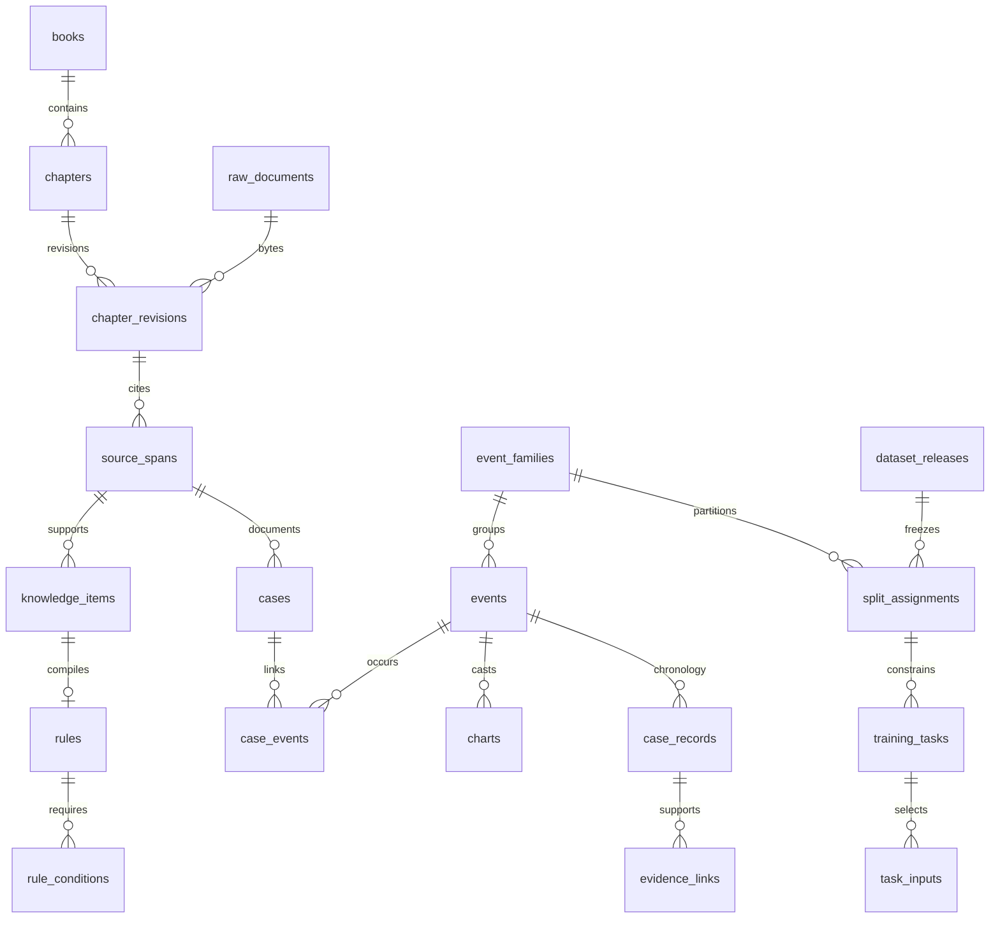

# 数据库 schema v1

权威 DDL：`src/qimenllm/knowledge/migrations/001_initial.sql`。`knowledge/db.py` 另外生成 append-only 触发器并纳入迁移哈希。SQLite 初始化为全空领域库，仅有 schema 迁移和 empty-v1 数据版本。

| 表组 | 表 | 主要关系与用途 |
|---|---|---|
| 迁移/版本 | schema_migrations, data_versions | schema 哈希、父版本、操作、操作清单哈希、时间 |
| 文献 | books, chapters | 多书/版次键、书章顺序、权利状态 |
| 原文 | raw_documents, chapter_revisions | SHA-256、BLOB、字节长度、显式追加修订、输入来源、数据版本 |
| 来源 | source_spans, source_reviews | 字节范围及定位；来源确认独立追加 |
| 索引 | chapter_search | FTS5 中的完整原文，支持审计和字面检索 |
| 概念/方法 | concepts, concept_links, methods | 定义出处、跨书关联、方法版本及约定 JSON |
| 知识/规则 | knowledge_items, rules, rule_conditions | 分层类别、独立状态、方法/领域/子类、绑定 JSON、必要/排除条件 |
| 分歧 | rule_disagreements | 条文间分歧及出处，未解决不得自动合并 |
| 故事/事件 | cases, events, case_events, event_families | 完整案例、多事件、多书同事件、分组家族 |
| 盘 | charts | 同一事件多盘；原盘/引擎整体 JSON、方法、可缺时间地点、哈希、验证状态 |
| 作者过程 | case_records, evidence_links | 对话、用神、分析、断语、应期、反馈、续断、结局；逐步来源和盘规则证据 |
| 数据发布 | dataset_releases, split_assignments | 版本/清单/冻结；同 release 同家族唯一 split |
| 候选任务 | training_tasks, task_inputs | 任务类型、目标、cutoff、来源版本、哈希、审核状态、仅可知输入 |

## 可执行约束

- 每连接启用 foreign_keys，数据操作使用事务，导入先 BEGIN IMMEDIATE。
- 原文字节长度与 BLOB 类型检查；原文 SHA 唯一；书章键、修订号和章节同文唯一。
- source span 非空、不超出原文；Python 标注与 audit 进一步检查 UTF-8 边界。
- 关键 JSON 有效；枚举和布尔状态有 CHECK；训练许可与 evaluation_only 不能同时为真。
- 来源、知识版本、规则、历史盘、作者记录、事件关系及候选任务 append-only。
- `(chart_id,event_id)` 复合 FK 防止对话关联别事件盘；evidence trigger 防止跨事件证据盘。
- 事件家族唯一分组；task 的 family 必须与 event 相同，split 必须匹配分组；目标必须同事件、显式作者记录并在 cutoff。
- task_inputs 只能引入同事件、cutoff 前、非目标、事前显式对话；未来信息及反馈阻断。
- release 只允许从未冻到冻结；冻结后不能重分组、解冻、删除或追加任务/输入。

SHA-256 内容校验由导入和 audit 执行，数据库 CHECK 只验证长度，不在 SQLite 内伪装密码学。完整来源、原文镜像、索引一致性、盘内容哈希另行审计。语义条件与信息时序仍需要来源审查，不能用 schema 代替专业判断。

## 版本与扩展

data_versions 是当前操作链，manifest_sha256 代表该操作规范化清单，不等于全库快照哈希；全量可复现快照使用 SQLite backup 的文件哈希、源码 commit、镜像文件清单和未来数据 release。不得混称二者。

原始媒体、专业结构化九宫、细粒度人物/宫位关系、观测的独立确认、正式数据发布工具等将在来源与验收条件具备后按 migration 扩展。JSON 预留未知历史信息，不以虚构值凑列。
